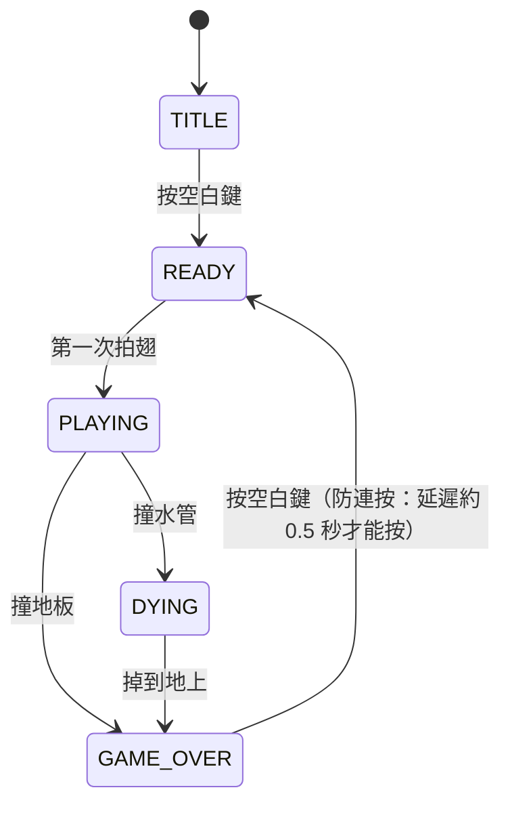

# 水管鳥（Flappy Bird）復刻 — 實作計劃書

## 目標
- 盡量照原版的手感、畫面、流程來復刻
- **分數依存活時間計算**（每 0.1 秒 +1，數字一直往上跳）
- 第一版用**鍵盤**操作；**第二版加上聲音控制**（音量 / 音調）
- 從一開始就把「輸入」拆成獨立模組，之後接麥克風時不用動遊戲核心

---

## 1. 技術選型（以「之後要用聲音操作」為前提）

| 項目 | 選擇 | 理由 |
|---|---|---|
| 平台 | 瀏覽器 | Web Audio API 內建麥克風擷取、音量分析，音調偵測也能做，不用另外裝套件 |
| 專案工具 | **Vite + 純 JavaScript（ES Modules）** | 麥克風（`getUserMedia`）一定要在 `localhost`/HTTPS 下才能用，用 `file://` 直接開會失敗；Vite 剛好提供本機伺服器，熱更新也方便 |
| 繪圖 | Canvas 2D | 原版就是像素圖，Canvas 最適合，關掉 `imageSmoothingEnabled` 讓像素保持銳利 |
| 音效 | Web Audio 合成 | 不需要音效檔，跟之後的麥克風功能共用同一個 `AudioContext` |
| 存檔 | `localStorage` | 存最高分 |

> [!NOTE]
> 不建議 Pygame / Jac：桌面版做麥克風的音調偵測要多裝 `pyaudio`、`numpy` 之類的套件，Windows 上安裝常出問題，而且也不能直接分享網址給別人玩。

---

## 2. 專案結構

```
voice/
├─ index.html
├─ package.json
├─ public/assets/sprites/     # 生成的像素圖
├─ src/
│  ├─ main.js                 # 進入點、遊戲迴圈（固定時間步長）
│  ├─ config.js               # 所有物理/尺寸/計分參數集中在這
│  ├─ game.js                 # 狀態機：READY → PLAYING → DYING → GAME_OVER
│  ├─ entities/
│  │  ├─ bird.js              # 物理、旋轉、拍翅動畫
│  │  ├─ pipes.js             # 水管產生、回收、碰撞
│  │  └─ ground.js            # 地板捲動
│  ├─ render/
│  │  ├─ renderer.js          # 縮放、繪製順序
│  │  ├─ sprites.js           # 圖片載入與切圖
│  │  └─ ui.js                # 分數數字、Get Ready、Game Over 面板、獎牌
│  ├─ audio/sfx.js            # 合成音效
│  ├─ input/
│  │  ├─ InputManager.js      # 統一介面：控制器只輸出「指令」
│  │  ├─ KeyboardInput.js     # 第一版
│  │  └─ (VoiceInput.js)      # 第二版才加
│  └─ storage.js              # 最高分
└─ README.md
```

### 輸入抽象層（之後接聲音的關鍵）
所有控制器都實作同一個介面，遊戲本身不知道輸入是從哪裡來的：

```js
// 每個 frame 遊戲會問 InputManager：
{
  flap: boolean,          // 這個 frame 有沒有「拍一下」（鍵盤、音量觸發用）
  targetY: number | null, // 連續控制模式：目標高度 0~1（音調模式用），沒有就是 null
  confirm: boolean        // 開始 / 重來
}
```

---

## 3. 原版規格（邏輯解析度 288 × 512，等比放大到視窗）

| 參數 | 初始值 | 備註 |
|---|---|---|
| 畫面 | 288 × 512，地板高 112 | 依視窗高度整數倍或等比縮放，左右留黑邊 |
| 小鳥 | 34 × 24，x 固定在約 1/3 畫面 | 3 張拍翅動畫幀（上/中/下） |
| 重力 | ≈ 0.5 px/frame² | 用 60fps 固定時間步長，120/144Hz 螢幕手感才會一樣 |
| 拍翅 | 速度直接設為 ≈ -8 px/frame | 原版是「重設速度」，不是「往上加速度」 |
| 最大下墜速度 | ≈ 10 px/frame | |
| 旋轉 | 往上 -25°；下墜一段時間後轉到 +90°（俯衝） | 往上飛時抬頭、往下掉時低頭 |
| 水管 | 52 × 320，上下間隙 ≈ 100 px | 間隙位置隨機，有上下限 |
| 水管水平間距 | ≈ 156 px（兩水管之間） | |
| 捲動速度 | ≈ 2 px/frame（地板與水管同速） | **固定不變**（照原版） |
| 背景 | 白天 / 黑夜，每局隨機 | 背景不捲動（原版就是靜止的） |
| 小鳥顏色 | 黃 / 紅 / 藍，每局隨機 | |

> [!IMPORTANT]
> 數值是依網路上的原版反組譯資料估的起始值，做出來後我會實際玩過再微調手感。

### 碰撞
- 小鳥用比圖片小一點的圓形/矩形碰撞框（原版判定有點寬容）
- 撞水管 → 閃白 + 晃動 → 小鳥掉到地上 → Game Over
- 撞地板 → 直接結束；**頂部天花板不會死**，但飛不出水管頂端

---

## 4. 計分與獎牌

- **分數**：遊戲進行中每 0.1 秒 +1（用遊戲時間累計，不用真實時間，暫停分頁不會偷加分）
- 畫面上方中央用原版大號白字黑邊數字顯示，一直往上跳
- **獎牌換算**：原版是「通過水管數」，一根水管的間隔時間約 1.3 秒 ≈ 13 分
  - 銅牌：10 根 → **130 分**（約 13 秒）
  - 銀牌：20 根 → **260 分**
  - 金牌：30 根 → **390 分**
  - 白金：40 根 → **520 分**
  - 實作時用 `config.js` 依實際捲動速度自動算出門檻，調手感後仍保持一致
- **得分音效**：原版每過一根水管「叮」一聲 → 保留在**通過水管時**播放（只是音效，不加分），手感比較像原版
- 新紀錄：Game Over 面板上顯示紅色「NEW」標籤
- 最高分存 `localStorage`

---

## 5. 遊戲流程（狀態機）



| 畫面 | 細節 |
|---|---|
| TITLE | Logo + 小鳥上下飄 + 地板捲動 + 「按空白鍵開始」 |
| READY | 「Get Ready」字樣 + 點擊提示圖，小鳥原地上下飄，**沒有水管**，地板持續捲動 |
| PLAYING | 第一次拍翅才開始重力；水管約 1.5 秒後從右邊出現 |
| DYING | 閃白一下、畫面晃動、地板停止、小鳥俯衝掉落 |
| GAME_OVER | 「Game Over」字樣掉下來 → 分數面板從下方滑上來 → 分數由 0 跑到最終分數 → 獎牌閃光 → 出現重來按鈕 |
| 轉場 | 重來時黑幕淡入淡出 + swoosh 音效 |

### 鍵盤操作（第一版）
- `Space` / `↑`：拍翅、開始、重來
- `P`：暫停（原版有暫停鈕）
- `M`：靜音

---

## 6. 美術素材（由我生成，像素風、仿原版）

| 素材 | 內容 |
|---|---|
| 小鳥 | 黃/紅/藍 × 3 幀拍翅 |
| 水管 | 綠色水管本體 + 管口（上下各一） |
| 背景 | 白天（藍天、白雲、城市、樹叢）、黑夜（深藍、星點、亮燈城市） |
| 地板 | 可無縫捲動的條紋地板 |
| UI | Logo、Get Ready、Game Over、點擊提示、分數面板、4 種獎牌、NEW 標籤 |
| 數字 | 大號（遊戲中）＋ 小號（面板） 0–9 |

> [!WARNING]
> AI 生圖不一定能剛好對齊像素格，我會生成後再裁切成 sprite sheet；若某些小元件（數字、獎牌閃光）效果不好，改用程式碼逐像素繪製。

---

## 7. 音效（Web Audio 合成，仿原版五種）

| 音效 | 觸發 | 合成方式 |
|---|---|---|
| wing | 拍翅 | 短促向上掃頻 + 雜訊 |
| point | 通過水管 | 兩段清脆方波「叮～」 |
| hit | 撞到 | 低頻撞擊雜訊 |
| die | 撞水管後下墜 | 下降掃頻 |
| swoosh | 畫面切換 | 濾波白噪音掃過 |

瀏覽器規定使用者第一次按鍵後才能啟動 `AudioContext`，會在 TITLE 畫面處理。

---

## 8. 開發階段

### Phase 1 — 可玩核心
1. Vite 專案、Canvas 縮放、固定時間步長迴圈
2. 先用色塊代替圖片：小鳥物理、水管、地板、碰撞
3. 時間計分 + 狀態機

### Phase 2 — 原版外觀與手感
4. 生成並切好所有 sprite，換掉色塊
5. 小鳥旋轉、拍翅動畫、待機上下飄
6. 白天/黑夜、小鳥顏色隨機

### Phase 3 — 細節打磨
7. 閃白、晃動、Game Over 動畫、分數跑表、獎牌閃光、NEW
8. 合成音效
9. 最高分存檔、暫停、靜音
10. 手感調整（跟原版影片對照）

### Phase 4 — 聲音控制（之後再做，見下一節）

---

## 9. 聲音控制設計（第二版）

### 兩種模式

| 模式 | 玩法 | 優點 | 缺點 |
|---|---|---|---|
| **A. 音量拍翅**（建議先做） | 音量超過門檻 → 等同按一次空白鍵 | 完全保留原版物理和手感，最容易做 | 要持續發出「啊、啊、啊」 |
| **B. 音調控制高度** | 音越高小鳥越高，用平滑追蹤目標高度 | 很有趣、適合直播/派對 | 要改物理規則，跟原版手感不同；低音嗓/高音嗓要先校正 |
| （C. 音量控制高度） | 越大聲飛越高 | 不用會唱歌 | 環境噪音影響大 |

### 技術要點
- `navigator.mediaDevices.getUserMedia({ audio: { echoCancellation: false, noiseSuppression: false, autoGainControl: false } })`（關掉自動增益，音量才準）
- `AnalyserNode` 取時域資料 → 算 RMS 音量（dB）
- 音調偵測用**自相關法（autocorrelation）或 YIN**，範圍約 80–1000 Hz，音量太小時判定為無聲
- **校正畫面**：先量環境噪音 → 請玩家喊一聲（音量模式）或唱最低音、最高音（音調模式）
- **防誤觸**：門檻加遲滯（hysteresis）+ 冷卻時間約 150 ms，避免一聲觸發好幾次
- 遊戲本身的「wing」音效會被麥克風收到 → 聲音模式預設把遊戲音效調小或關閉，或建議戴耳機
- 畫面角落顯示即時音量條/音高指示，玩家才知道自己有沒有被偵測到

### 預先寫好的實作提示詞（Phase 4 直接貼給 AI）

**提示詞 1：音量拍翅模式**
```
請在現有的水管鳥專案中新增 src/input/VoiceInput.js，實作「音量拍翅」模式：
1. 用 getUserMedia 取得麥克風（關閉 echoCancellation、noiseSuppression、autoGainControl），
   與 src/audio/sfx.js 共用同一個 AudioContext。
2. 用 AnalyserNode 每個 frame 計算 RMS 音量並轉成 dB。
3. 音量由低於「放開門檻」上升到高於「觸發門檻」時輸出 flap=true（遲滯設計），
   兩次觸發之間至少間隔 150ms。
4. 遵守 InputManager 的介面 { flap, targetY, confirm }，targetY 固定為 null；
   在 READY / GAME_OVER 狀態下觸發時輸出 confirm=true。
5. 新增校正畫面：先錄 2 秒環境噪音取平均，再請玩家喊 3 次取平均，
   觸發門檻 = 噪音與喊聲的中間值，結果存 localStorage。
6. 畫面左下角顯示即時音量條與門檻線。
7. 標題畫面新增選單：鍵盤 / 聲音（音量），可隨時切換；麥克風權限被拒時顯示提示並退回鍵盤。
不要修改 bird.js 的物理參數。
```

**提示詞 2：音調控制高度模式**
```
請在 VoiceInput.js 新增「音調控制高度」模式：
1. 用 YIN 演算法（或自相關法）從 AnalyserNode 的時域資料偵測基頻，範圍 80–1000Hz，
   音量低於噪音門檻或信心值不足時視為無聲。
2. 校正畫面：請玩家唱最低舒服音與最高舒服音各 2 秒，取中位數作為 minHz / maxHz，存 localStorage。
3. 將音高以對數尺度（半音）映射到 0~1，輸出 targetY（1 = 畫面頂端，0 = 地板上方）。
4. 無聲時 targetY = null，小鳥照原本重力下墜。
5. 在 bird.js 新增「追蹤模式」：有 targetY 時，速度朝目標位置平滑逼近（類似彈簧阻尼，
   參數放 config.js），最大上升/下降速度有上限，旋轉角度依速度計算，維持原版抬頭/低頭的感覺。
6. 對音高做中位數濾波 + 指數平滑，避免小鳥抖動。
7. 畫面右側顯示音高指示條（目前音高、目標高度）。
8. 標題選單新增「聲音（音調）」選項。
```

**提示詞 3：調參與測試**
```
請新增一個除錯面板（按 D 開關），即時顯示並可調整：噪音門檻、觸發門檻、冷卻時間、
平滑係數、minHz/maxHz、追蹤模式的彈簧與阻尼參數，並顯示目前 dB、Hz、偵測信心值。
調整結果可一鍵存入 localStorage。
```

---

## 10. 驗證方式
- 用瀏覽器實際操作：開始 → 拍翅 → 撞水管 / 撞地板 → Game Over → 重來，錄製一段影片給你看
- 檢查：120Hz/60Hz 下速度一致、最高分重新整理後還在、獎牌門檻正確
- 截圖跟原版畫面並排比較

---

## 已確認的決定
1. **獎牌門檻**：照原版水管數換算，由 `config.js` 依捲動速度與水管間距自動計算（約每根水管 13 分）
2. 第一版支援**鍵盤 + 滑鼠 + 觸控**
3. 聲音控制 **A 音量拍翅、B 音調控制高度兩種都做**，標題畫面用開關切換（Phase 4）
